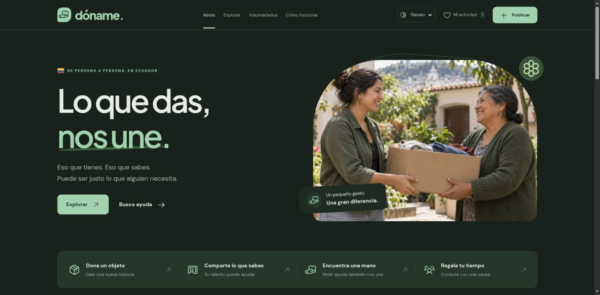

# dóname

**Lo que das, nos une.** MVP de una comunidad en Ecuador para donar objetos, compartir conocimientos, pedir ayuda y encontrar voluntariados.

- **Sitio público:** https://aurelioochoa.github.io/doname/
- **Explorar:** https://aurelioochoa.github.io/doname/explorar.html
- **Guía:** https://aurelioochoa.github.io/doname/guia.html
- **Publicar:** https://aurelioochoa.github.io/doname/publicar.html



## Ejecutar en local

Requiere Node.js 22 o superior. No necesita instalación ni compilación: los recursos están incluidos en `dist/`.

```bash
npm run dev
```

Abrir http://localhost:4173. Para verificar los módulos, filtros, validaciones y enlaces estáticos:

```bash
npm test
```

## Qué puedes probar

- Landing, catálogo, guía y publicación en páginas independientes.
- 40 oportunidades de ejemplo: 10 objetos, 10 servicios, 10 necesidades y 10 voluntariados, en distintas ciudades y categorías.
- Modo **claro, oscuro o del sistema**, persistente entre páginas y recargas.
- Animaciones de entrada y al desplazarse; respuesta al guardar, menús y botones. Se respeta la preferencia de movimiento reducido.
- Catálogo de objetos, servicios, necesidades y voluntariados.
- Búsqueda sin distinguir tildes o mayúsculas; ciudad, categoría, modalidad y orden.
- Filtros en URL, chips para retirarlos y búsquedas compartibles.
- Vista de tarjetas o lista y filtro de favoritos.
- Enlaces directos a los detalles de anuncios de ejemplo.
- Publicación en tres pasos: elegir el gesto, añadir detalles/foto y definir ciudad/contacto. Vista previa que se actualiza mientras escribes, contadores de caracteres y validación por paso.
- Edición desde la misma pantalla, archivo, restauración y estado completado.
- Borrador de texto recuperable del formulario. No guarda el teléfono ni la foto.
- WhatsApp solo con autorización de quien publica; sin autorización el número no se guarda.
- Resumen de actividad local, registro de horas y constancia de ejemplo imprimible.
- Menú móvil, teclado, diálogos nativos y preguntas frecuentes.

## Alcance del MVP

**Sin login, sin cuentas y sin backend.** Los anuncios iniciales son ejemplos. Las publicaciones nuevas, favoritos, intereses, borradores y horas se guardan en el almacenamiento local del navegador y no se sincronizan con otras personas o dispositivos. Publicar el sitio en GitHub Pages no convierte estos datos en una base de datos compartida.

Los enlaces de anuncios de ejemplo funcionan en cualquier navegador. Los anuncios que creas localmente no tienen un enlace público compartible. El contacto de WhatsApp solo abre un borrador; nunca envía mensajes automáticamente. Las constancias usan horas autodeclaradas y no tienen acreditación institucional.

## Publicación automática

`.github/workflows/pages.yml` verifica la aplicación en pushes y pull requests. Los pushes a `main` publican `dist/` en GitHub Pages mediante un entorno `github-pages`. Las acciones están fijadas a sus SHA. No se necesitan secretos propios ni pasos de compilación.

## Estructura

| Archivo | Propósito |
| --- | --- |
| `dist/index.html` | Landing de presentación |
| `dist/explorar.html` | Catálogo y búsqueda |
| `dist/guia.html` | Ayuda y preguntas frecuentes |
| `dist/publicar.html` | Publicación y edición por pasos |
| `dist/publish.js` | Borrador, foto, validación y vista previa de publicación |
| `dist/opportunities.js` | Nuevas oportunidades de ejemplo |
| `dist/app.js` | Interacciones, formularios, rutas y actividad local |
| `dist/core.js` | Datos de ejemplo, filtros, URL, validación y persistencia |
| `dist/theme.js` | Tema antes del primer render, sistema y persistencia |
| `dist/styles.css` | Base visual del MVP |
| `dist/experience.css` | Páginas, temas, animaciones y mejoras responsive |
| `dist/publish.css` | Formulario por pasos, vista previa y estilos móviles |
| `scripts/serve.mjs` | Servidor local sin dependencias |
| `scripts/verify.mjs` | Comprobaciones de regresión y rutas estáticas |
| `scripts/check-opportunities.mjs` | Verificación de variedad, datos y recursos de los ejemplos |
| `design/ASSETS.md` | Procedencia, prompts y licencias de recursos |
| `QA.md` | Recorridos verificados |
| `GATES.md` | Criterios y evidencia de aceptación |

Los originales de las imágenes se conservan en `design/originals/`. Los paquetes Fontsource y Phosphor figuran en `package.json` para poder recuperar las fuentes e iconos; sus versiones servidas ya están en `dist/assets/`.
